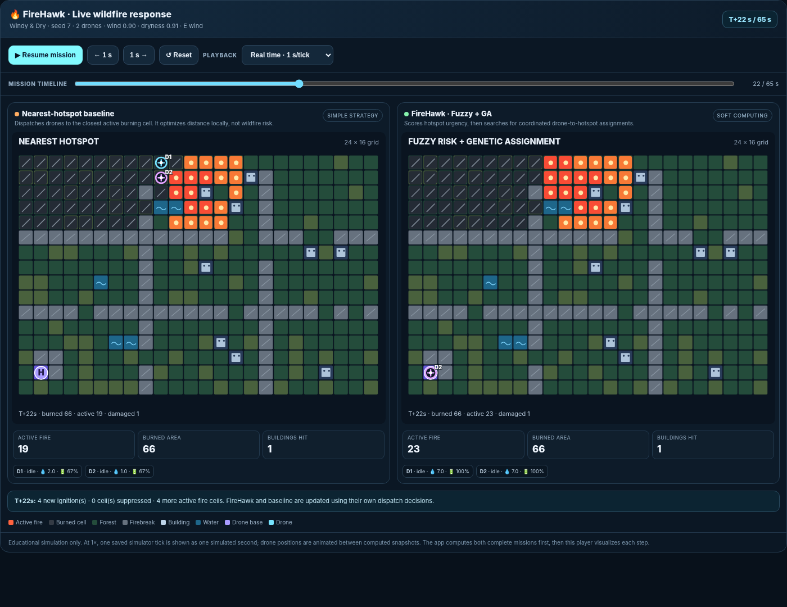
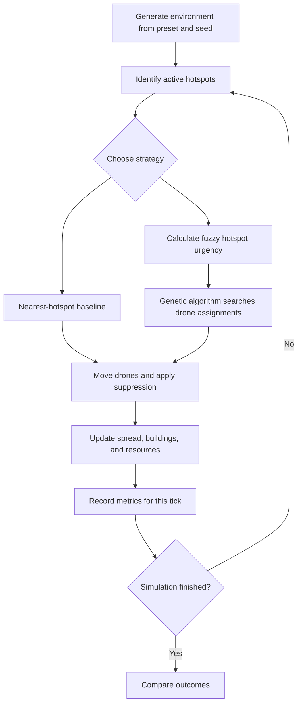

<div align="center">

# 🔥 FireHawk
### Wildfire Response Lab — Fuzzy Logic + Genetic Algorithm

**A visual, interactive wildfire-response simulator that compares a simple nearest-hotspot strategy with a fuzzy-guided, genetically optimized multi-drone strategy.**


[Overview](#-the-project) · [Demo](#-see-the-demo) · [How It Works](#-how-it-works) · [Run Locally](#-run-locally) · [Deploy](#-deploy-to-streamlit-community-cloud) · [Results](#-compare-the-strategies)

</div>

---

## 🌲 The Project

**FireHawk** is a Soft Computing AAT project about allocating a small fleet of firefighting drones to active wildfire hotspots. It creates a fixed or seed-reproducible environment containing terrain, vegetation, fire, wind, buildings, and limited drone resources. Two approaches are evaluated under the same initial conditions:

| Mode | What it does |
|---|---|
| 🟠 **Nearest-Hotspot Baseline** | Sends each available drone toward a nearby active fire, using a simple dispatch rule. |
| 🔥 **FireHawk Fuzzy + GA** | Uses fuzzy logic to estimate hotspot urgency, then uses a custom genetic algorithm to search for better joint drone-to-hotspot assignments. |

The aim is to demonstrate how a decision policy can change the simulated outcome—not simply to display a chart. Drones move, fires spread, suppression changes the fire state, and mission metrics update through time.

> ⚠️ **Important:** FireHawk is an educational simulation. It is not a wildfire prediction model, real drone-control system, or emergency decision-support tool. The environment and impact metrics are simplified and must not be interpreted as real-world forecasts.

## 🎮 See the Demo

The first screen presents a reference scenario so the app is not an empty dashboard on launch.

<div align="center">



<sub>Preview of the mission player. In the application, the timeline controls animate drone movement and update the displayed simulation state.</sub>

</div>

### The four app sections

- **🚁 Live Simulation** — view both strategies side by side; start, pause, step, reset, change playback speed, and scrub the simulation timeline.
- **📊 Compare Results** — compare burned area, damaged buildings, building exposure, active fire, containment, drone distance, and resource use.
- **🧠 Algorithm Details** — inspect the fuzzy inputs, urgency rules, chromosome, fitness, and genetic operators.
- **📘 Project Guide** — read the problem formulation, simulation sequence, SDG relevance, limitations, and viva summary.

### Try these scenarios

| Scenario | What to observe |
|---|---|
| **Calm & Clear** | A lower-stress environment where the two approaches may be closer in performance. |
| **Windy & Dry** | Stronger fire-spread pressure; watch whether urgency-aware assignments change the outcome. |
| **Near Buildings** | Hotspots near buildings can receive greater fuzzy urgency. |
| **Resource Constrained** | Test a smaller fleet and observe the trade-off between response coverage and travel. |
| **Randomized Scenario** | Change the seed to generate a different but reproducible environment. |

Both strategies receive the same terrain, initial fire conditions, weather, and pre-generated spread-noise field for a fair paired comparison.

## 🧠 How It Works



### 1. 🌡️ Fuzzy Logic — estimate urgency

The fuzzy controller converts crisp simulation inputs into interpretable urgency values. The project uses manually implemented membership functions and a rule base built around:

- **Fire intensity** — how severe the hotspot is.
- **Threat to buildings** — how close the fire is to building locations.
- **Spread potential** — how much conditions such as dryness and wind favour further spread.

Illustrative rule: **IF** intensity is high **AND** building threat is high, **THEN** hotspot urgency is very high.

The project implements the membership functions, rule evaluation, and output calculation directly; it does not call a ready-made fuzzy-logic package.

### 2. 🧬 Genetic Algorithm — search assignment combinations

The GA encodes a joint assignment of available drones to candidate hotspots. It evaluates candidate assignments with a fitness function that balances hotspot urgency and travel while penalizing poor or redundant assignments. The implementation includes:

- Population initialization and chromosome decoding.
- Fitness evaluation using the simulation's urgency and travel measures.
- Tournament selection.
- Crossover and mutation.
- Elitism and valid-assignment handling.

The GA is a search heuristic; it is not guaranteed to find the globally optimal assignment on every run. Different seeds and environments can produce different relative outcomes, which is why the project includes multi-seed evaluation.

### 3. 🔁 Paired simulation — compare fairly

Each strategy runs from equivalent starting conditions. At each tick, drones travel toward assigned hotspots, use limited suppression resources, and the simulator updates fire spread and impacts. The application records the actual simulated state and computes metrics from it.

## 📈 Compare the Strategies

The dashboard reports multiple outcomes rather than relying on a single success percentage.

| Metric | Meaning |
|---|---|
| **Burned area (cells)** | Number of vegetation/scrub cells ignited during the run, including cells that later go out. |
| **Buildings damaged** | Buildings whose simulated heat accumulation crosses the configured damage threshold. |
| **Building exposure** | Accumulated fire intensity next to building locations, in model units. |
| **Peak active fire** | Highest simultaneous count of burning cells. |
| **Containment** | Whether active fire reaches zero within the selected simulation duration. |
| **Drone distance** | Total grid steps travelled by the fleet. |
| **Water / battery use** | Context for the resources spent to suppress fire. |

### Bundled reference run

The bundled reference case uses **Windy & Dry · seed 7 · 2 drones · 65 ticks**.

| Metric | Nearest-hotspot baseline | FireHawk Fuzzy + GA |
|---|---:|---:|
| Burned area | 242 cells | 114 cells |
| Buildings damaged | 9 | 3 |
| Building exposure | 119.74 model units | 35.46 model units |
| Peak active fire | 54 cells | 30 cells |
| Active fire at final tick | 20 cells | 0 cells |
| Drone distance | 147 grid cells | 159 grid cells |
| Containment during run | No | Yes, at tick 53 |

In this particular reference run, FireHawk has **52.9% lower burned area**, **66.7% fewer damaged buildings**, and **70.4% lower building exposure**, while travelling farther. These figures are specific to the bundled synthetic scenario, not a general guarantee. The bundled five-seed benchmark also includes a case where FireHawk does not win every primary impact metric; report the complete results rather than selecting only the best run.

The reference CSVs are in [`results/`](results/):

- [`reference_comparison.csv`](results/reference_comparison.csv) — summary metrics for the reference run.
- [`reference_timeline.csv`](results/reference_timeline.csv) — per-tick metrics for the animated comparison.
- [`multi_seed_benchmark.csv`](results/multi_seed_benchmark.csv) — robustness results across multiple seeds.

## 🚀 Run Locally

### Requirements

- Python **3.10 or newer**.
- Internet access for the first dependency installation.

### Windows

1. Download or clone this repository.
2. Open the project folder.
3. Double-click `start_firehawk.bat`.
4. Wait for the environment and dependencies to install.
5. Open the local URL shown in the terminal, usually `http://localhost:8501`.

Keep the terminal open while using the app.

### Linux / macOS

```bash
chmod +x start_firehawk.sh
./start_firehawk.sh
```

Or run manually:

```bash
python -m venv .venv
# Windows: .venv\Scripts\activate
# Linux/macOS: source .venv/bin/activate
python -m pip install -r requirements.txt
streamlit run app.py
```

## ☁️ Deploy to Streamlit Community Cloud

1. Push the project files to a GitHub repository.
2. Open [Streamlit Community Cloud](https://share.streamlit.io/) and sign in with GitHub.
3. Choose **Create app** and select your repository and branch.
4. Set **Main file path** to `app.py` because it is located at the repository root.
5. Deploy and wait for Streamlit to install the packages listed in `requirements.txt`.

No API keys, database credentials, or secrets are required for this project. See [`STREAMLIT_DEPLOY.md`](STREAMLIT_DEPLOY.md) for deployment notes.

## 🧪 Tests and Reproducibility

Run the automated test suite from the project root:

```bash
python -m unittest discover -s tests -v
```

Regenerate the multi-seed benchmark:

```bash
python run_benchmark.py --seeds 7 13 29 47 71 --steps 65 --out results/multi_seed_benchmark.csv
```

A fixed seed makes a scenario reproducible. Change the seed to explore a different environment. If the implementation or simulation assumptions change, regenerate reference data before using old numbers in a report.

## 🌍 SDG Alignment

- **Primary — SDG 11: Sustainable Cities and Communities.** The simulator includes building exposure and simulated building damage, connecting the project to community resilience and safer settlements.
- **Secondary — SDG 13: Climate Action.** Windy and dry scenarios let us explore response planning under hazardous conditions. The simulator does not model climate change or quantify climate impacts.

The project offers a possible distinct topic around **fuzzy-guided genetic optimization for multi-drone wildfire hotspot suppression**. The assignment includes related sustainability and emergency-planning areas; confirm the exact topic scope with the faculty member before final submission.

## 🗂️ Project Structure

```text
FireHawk_Streamlit_Deploy/
├── app.py                         # Streamlit application and pages
├── requirements.txt               # Runtime dependencies
├── firehawk/
│   ├── fuzzy.py                   # Manual fuzzy membership/rule engine
│   ├── genetic.py                 # Manual genetic algorithm
│   ├── simulation.py              # Fire, drones, suppression, metrics
│   ├── scenarios.py               # Presets and seeded map generation
│   ├── visuals.py                 # SVG maps and animated player
│   └── metrics.py                 # Comparison summaries
├── results/                       # Reference CSVs and preview image
├── tests/                         # Unit and simulation tests
├── docs/
│   ├── PROJECT_SPEC.md            # Technical formulation
│   └── VIVA_GUIDE.md              # Viva preparation
├── run_benchmark.py               # Multi-seed robustness check
└── STREAMLIT_DEPLOY.md            # Deployment notes
```

## 👨‍💻 Built For

**Soft Computing AAT · B.M.S. College of Engineering, Bengaluru**

**Proposed project title:** *FireHawk: Fuzzy-Guided Genetic Optimization for Multi-Drone Wildfire Hotspot Suppression.*

The core fuzzy and genetic algorithms are implemented manually. Streamlit is used for the interface and pandas for data tables/CSV export.

---

<div align="center">

**🔥 Think clearly. Allocate intelligently. Compare honestly.**

<sub>Educational simulation only · Reproducible experiments · Actual results, including negative outcomes</sub>

</div>
